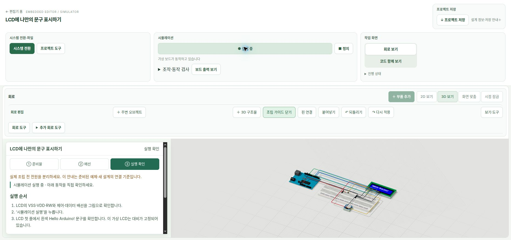

# 편집기에서 아두이노 따라 하기

편집기 홈 `http://127.0.0.1:8768/`의 **아두이노 따라 하기 예제**에서 **가이드와 함께 열기**를 누릅니다. API 키·사진 분석 없이 완성된 회로·배선·코드를 불러옵니다. 첫 화면의 ‘아두이노 편집기 열기’도 첫 LED 예제로 연결됩니다.

| 순서 | 예제 | 확인할 동작 |
| --- | --- | --- |
| 1 | LED 깜빡이기 | 0.5초 켜짐 / 0.5초 꺼짐 |
| 2 | LED 밝기 부드럽게 조절하기 | 20ms마다 PWM 값을 5씩 바꾸며 밝아졌다 어두워짐 |
| 3 | 버튼으로 LED 제어하기 | 누르는 동안 켜지고 놓으면 꺼짐 |
| 4 | 어두우면 켜지는 자동 조명 | 가상 조도 센서를 어둡게 하면 LED 켜짐 |
| 5 | LCD에 나만의 문구 표시하기 | 흰색 Hello Arduino! 문구 표시 |

1. **① 준비물**에서 부품명·수량·학습 목표를 확인합니다. 화면에는 완성 회로가 미리 놓여 있습니다.
2. **② 배선**에서 ‘이전/다음 단계’로 이동합니다. 부품의 모든 다리는 한 단계로, 점퍼선도 양 끝을 한 단계로 안내합니다. 그림의 빵판 구멍 번호와 3D 포인터를 대조하세요. ‘3D 연결 위치 확대’로 해당 핀을 확대합니다. LCD처럼 두 부품을 직접 연결하는 선도 별도 그림을 제공합니다.
3. **③ 실행 확인**에서 실행 순서를 읽고 상단 **시뮬레이션 실행**을 누릅니다. 각 입력과 출력이 안내대로 반응하는지 직접 확인해 체크하세요. 체크는 자동 검증 결과가 아닙니다.
4. ‘코드가 하는 일’, ‘값을 바꿔 도전해 보기’를 펼쳐 학습합니다. 상단 **코드 함께 보기**에서 편집하고 **프로젝트 저장**으로 `.vlx`를 보관합니다.

배선을 수정하면 기존 안내와 다른 연결의 핀 강조는 숨깁니다. 실물로 조립할 때는 전원을 분리하고 실제 보드·부품의 핀과 정격을 확인하세요. 특히 조도 센서의 AO 출력 방향·임계값은 모듈별 보정이 필요합니다. LCD 모델의 예제 문자는 영문·숫자 기준입니다. 가상 LCD의 대비는 고정이며 가변저항은 실물 연결을 위한 배선 학습용입니다.

## 코드 위치

- `services/editor/data/arduino-lessons.json`: 예제 설명·코드 해설·실행 확인 항목.
- `services/editor/backend/examples.py`: 검증된 기존 회로 템플릿에서 배선·코드·재료 목록을 함께 생성.
- `/api/editor/lessons`, `/api/editor/lessons/{id}`: 학습 목록과 프로젝트 API.
- `services/editor/patches/velxio-arduino-lessons.patch`: 편집기 학습 패널, 짧은 프로젝트 주소에서의 가이드 로딩, 직접 배선 그림.

기존 보드별 설계 예제와 사용자 프로젝트는 유지합니다. 예제마다 브라우저 초안의 키를 분리해 다른 예제의 코드가 덮어쓰지 않게 합니다.

## 검증 기록 (2026-11-16)

- Python 39개, 편집기 가이드·실제 MCU 동작 검사 22개 통과. 예제 5개의 준비된 소스를 로컬 격리 컴파일했습니다.
- 홈·튜토리얼 JS 검사 2개 파일 통과. 설치 빌드 성공.
- 관리 패치 35개를 고정 원본에 순서대로 재적용해 설치 소스 243개와 일치를 확인했습니다.
- Chrome에서 목록 5개, 준비물 → 배선 → 실행 확인 이동, 빵판 그림과 3D 강조, LCD의 부품 간 직접 연결 그림, LED·LCD 실행 상태를 확인했습니다. LCD 화면에 실제 가상 MCU가 출력한 흰색 문자가 표시되는 것도 확인했습니다.
- 유료 AI 호출·사진 재분석 없이 진행했습니다. 실물 조립 검증은 별도입니다.

