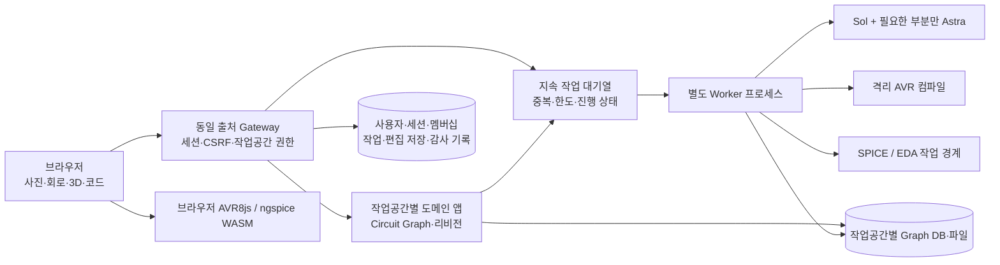

# SaaS 아키텍처와 1차 구현

2026-10-28 후속 변경: 로컬 SaaS 미리보기의 로그인은 현재 비활성화되어 있다. `bash run_saas.sh` 후 http://127.0.0.1:8770 에 접속하면 로그인 없이 **기본 작업공간**이 열린다. 사진·회로·코드는 이 작업공간에 계속 저장된다. 기존 계정/비공개 작업공간은 보존하고 자동으로 공개하지 않는다.

로그인을 다시 켜려면 `EV_SAAS_AUTH_ENABLED=1 bash run_saas.sh`로 API 서버를 재시작한다. 로그인 없는 모드는 개발용 loopback 주소에서만 허용한다. 운영 환경은 인증을 기본 사용한다.

2026-10-28. 로컬 단일 사용자 프로그램에 인증·작업공간·지속 작업 대기열·서버 저장을 담당하는 별도 서비스 계층을 추가했다. 기존 회로 추론/검증/EDA 코드를 재사용하는 **모듈형 모놀리스**다. 이는 기능 모듈을 분리하되 배포 단위를 과도하게 늘리지 않는 방식이다.

현재 구현은 **한 호스트의 API 1개 + 별도 worker 프로세스 + SQLite/WAL + 작업공간별 파일 저장소**다. 여러 서버에 배포된 상용 서비스가 완성된 상태는 아니다. 기존 localhost 프로그램과 사용자의 원본 데이터는 별도로 유지한다.

## 구조



KiCad MCP는 현재 데스크톱/호스트 런타임과 완전히 격리됐다고 가정하지 않는다. SaaS의 KiCad 생성·MCP 실행은 기본 503으로 차단한다. 작업공간 전용 실행 환경을 준비한 운영자만 `EV_SAAS_ISOLATED_EDA=1`로 열 수 있다. 이 설정 자체가 컨테이너/OS 격리를 만들어 주는 것은 아니다. 로컬 프로그램의 기존 KiCad 경로는 유지한다.

## 바뀐 점

| 항목 | 기존 로컬 | SaaS 계층 |
|---|---|---|
| 사용자 | 한 명, 로그인 없음 | 서버 세션, 비밀번호 해시, 만료·로그아웃 |
| 소유권 | 모든 프로젝트가 같은 저장소 | 사용자 → 멤버십 → 작업공간 → 프로젝트 |
| 권한 | localhost 접근 | owner/editor/viewer; 모든 API와 작업 실행 시 재확인 |
| 주소 | 8766 분석 + 8768 편집기 고정 | 한 출처의 `/w/{workspace}/`, `/w/{workspace}/editor` |
| API | `/api/projects/...` | `/api/w/{workspace}/projects/...` |
| 데이터 | `.runtime/projects.sqlite3` 및 공통 파일 | `saas/tenants/{workspace}/projects.sqlite3`와 전용 파일 |
| 코드·회로 편집 | 브라우저 임시 저장·파일 | 기존 방식 + 작업공간 서버 저장·리비전 충돌 검사 |
| 작업 처리 | HTTP 요청/메모리/스레드에 결합 | API는 제출, worker가 DB 대기열에서 가져와 실행 |
| 재시작 | 메모리 작업 결과 일부 소실 | 대기 작업·완료 결과 지속; 실행 중 유실은 interrupted |
| 모델 키 | 로컬 서버 설정 파일 허용 | worker 환경변수만 사용. API 스크립트는 키 제거 |
| 한도 | 일부 메모리 제한 | 작업공간당 대기·실행 8개, 일일 100개, 서버 전체 대기·실행 128개 |

서버 편집 저장은 **‘작업공간에 저장’ 버튼**으로 수행한다. 브라우저 임시 저장과 구분한다. 다시 열 때 서버 저장본을 우선하고, 다른 브라우저 초안이 있으면 복구본을 보존해 상세 안내에서 복원할 수 있게 한다. 두 탭의 저장 충돌은 409로 거절하며 자동 덮어쓰기하지 않는다. 편집 결과를 원본 관측 Graph나 KiCad에 자동 역반영하지 않는다.

## 경계와 데이터 모델

`backend/application.py`는 저장 경로를 주입받는 도메인 앱 factory이며, 모듈을 가져오는 것만으로 로컬 저장소를 열지 않는다. 기존 `backend/api.py`는 로컬 실행 호환 진입점으로 유지한다.

`backend/saas/`:

- `settings.py`: 데이터 루트, 정확한 공개 origin, HTTPS·개발 모드, 한도. HTTP 개발은 loopback만 허용.
- `repository.py`: 사용자, 작업공간, 멤버십, 세션, 대기 작업, 편집 저장본, 감사 기록. SQLite/WAL 초기 스키마 버전 1.
- `tenancy.py`: 인증된 작업공간별 기존 도메인 앱을 만들고 전용 저장 경로에 고정. 클라이언트 헤더로 저장 경로를 선택하지 않는다.
- `app.py`: 인증·CSRF·역할 확인, 파일 접근, URL 라우팅, 작업 제출, 서버 편집 저장.
- `worker.py`: 별도 프로세스에서 durable job 처리. 실제 AVR 컴파일과 기존 도메인 함수를 호출.
- `cli.py`: 관리자가 직접 계정과 첫 작업공간 생성. 비밀번호는 `getpass`로만 입력하고 argv/로그에 기록하지 않음.

Circuit Graph는 전기 회로의 중간 표현으로 유지한다. SaaS 소유권은 Graph 내부 추론값에 섞지 않고 서버의 작업공간 저장 경계에 둔다. 기존 revision·원본 관측 불변·CONFIRMED/INFERRED/UNKNOWN 규칙을 유지한다.

핵심 저장 키:

```text
members: (workspace_id, user_id) -> role
jobs: workspace_id + actor + job_id + status + lease + result
drafts: (workspace_id, source_project_id, design_key) -> revision + .vlx
tenant files: tenants/{workspace_id}/<project_id>.png + planner/<project_id>/...
```

클라이언트에서 작업공간 ID를 보내도 멤버십이 없으면 404다. 다른 작업공간의 프로젝트 ID를 알더라도 이미지·JSON·이력·계획·산출물·컴파일 결과를 읽을 수 없다. 작업공간 ID가 URL에 고정되므로 다른 탭에서 작업공간을 바꿔도 현재 탭의 저장 대상이 바뀌지 않는다.

세션은 충분히 긴 무작위 토큰이며 DB에는 해시를 저장한다. 운영 쿠키는 `__Host-ev_session`, Secure, HttpOnly, SameSite=Strict다. 비밀번호는 salt와 PBKDF2-HMAC-SHA256 600,000회로 해시한다. 쓰기는 정확한 Origin과 세션에 연결된 CSRF 토큰을 요구한다. 요청 본문은 chunked 입력도 상한 적용 후 파싱한다.

## 작업 처리

1. API가 멤버십·편집 권한·프로젝트 소유 범위를 확인한다.
2. 작업과 workspace/actor/입력 버전을 DB 트랜잭션으로 기록하고 작업 ID를 돌려준다.
3. worker가 원자적으로 한 작업을 claim하고 lease/heartbeat를 유지한다.
4. 실행 직전에 사용자 활성화 상태와 멤버십을 다시 확인한다.
5. 기존 Graph 리비전 검사 후 실제 도메인 함수/컴파일러를 호출한다.
6. 결과를 같은 작업공간에 저장한다. 프런트는 작업 ID로 진행·결과를 조회한다.

사진 업로드 후의 자동 부품 분석도 이 대기열로 전달한다. 기존 AutoAnalysis의 Sol/Astra 라우팅은 유지하며, 완료/실패 상태와 입력 해시 검사를 재사용한다. 비용이 든 요청을 중복 실행하지 않도록 기록을 먼저 저장한 후 대기열에 공개한다.

모델 추론, 서버 회로 분석·시뮬레이션·임베디드 실행·계획 등의 긴 JSON 작업은 202 + status URL을 반환하고 클라이언트가 기다린다. 컴파일 API는 기존 Velxio의 시작/상태 조회 계약에 맞춰 별도 큐를 사용한다. 사진 정규화·영상 프레임 추출은 이번 단계에서 업로드 경로에 남아 있다.

worker 유실 시 lease가 만료된 실행은 `interrupted`이며 자동 재실행하지 않는다. 이미 과금됐거나 외부 도구가 실행됐는지 모르는 작업을 자동으로 반복하지 않기 위해서다. 대기 중이던 작업은 재시작 후 처리한다. 컴파일 실패는 현재 작업의 stderr만 반환하고 이전 HEX를 재사용하지 않는다.

현재 한도는 **작업 수**다. 실제 토큰 비용·구독 요금·실시간 과금 상한 측정이 아니다. 모델 사용 가능 여부는 worker가 공개하는 불리언 heartbeat로 API에 전달하며 API 서버에 모델 키를 전달하지 않는다.

## 로컬에서 SaaS 모드 실행

기존 `bash run.sh`, `bash run_workbench.sh`는 그대로 사용할 수 있다. 새 모드는 기본 http://127.0.0.1:8770 이다.

```bash
cd /home/snowflower/CVR_LAB/PCB/embedded_vision

# 현재는 계정 생성 없이 사용한다. 서로 다른 터미널
bash run_saas.sh
bash run_saas_worker.sh
```

필요한 Python 의존성은 기존 가상환경에 있다. 새 편집기 소스는 기존 `scripts/setup_workbench.sh`로 빌드한다. `patches/velxio-embedded.patch`와 lock 파일에 SaaS 변경도 포함한다.

모델 키 파일은 `.runtime/saas-worker.env`이며 첫 줄은 `OPENAI_API_KEY=`다. `bash configure_saas_openai.sh`를 실행해 키를 숨김 입력하면 소유자만 읽고 쓰는 권한 600으로 저장한다. worker는 이 파일을 셸로 실행하지 않고 값만 읽어 자기 프로세스의 `OPENAI_API_KEY` 환경변수로 설정한다. API 서버·브라우저에는 키를 전달하지 않는다.

실행 중인 worker는 다음 대기 주기에 파일을 다시 읽고 모델 연결 상태를 갱신한다. 이미 처리 중인 작업은 마친 후 반영한다. 키가 비어 있거나 제거되면 파일에서 주입한 환경변수도 해제한다. 운영 시스템이 직접 주입한 `OPENAI_API_KEY`가 있으면 그 값이 우선한다. `EV_SAAS_WORKER_ENV`로 파일 경로를 지정할 수 있다. 설정 여부만 확인하려면 `.venv/bin/python -m backend.saas.envfile check`를 사용한다. 이 명령은 키를 출력하거나 API 요청을 보내지 않는다.

키를 채팅·브라우저·명령줄 인수에 넣지 않는다. 기존 `configure_openai.sh`는 로컬 모드용이다. 실제 키 없이도 프로젝트 저장·3D 편집·AVR 컴파일은 사용할 수 있다. [OpenAI 공식 환경변수 안내](https://developers.openai.com/api/docs/quickstart#create-and-export-an-api-key).

API/worker/CLI는 같은 `EV_SAAS_DATA`, `EV_SAAS_ORIGIN`을 사용해야 한다. `deploy/saas.env.example`은 설정 예제이며 비밀은 포함하지 않는다. API와 worker를 여러 개의 호스트에서 공유하는 구성을 이 SQLite 어댑터로 시도하지 않는다. 파일 기반 분석 기록 때문에 현재 API 프로세스는 1개로 유지한다.

## 운영 환경으로 확장할 순서

1. 실제 도메인·TLS reverse proxy와 서비스 계정 구성. 공개 배포는 이번 작업에서 수행하지 않았다. `deploy/nginx-saas.conf.example` 참고.
2. 인증 공급자(OIDC) 연결, 비밀번호 복구·가입/초대·멤버 관리 UI 추가. 현재는 관리자 CLI로 계정을 생성하며 공개 가입/메일 전송이 없다.
3. control DB와 Graph revision 저장소를 PostgreSQL로 이관. workspace_id 강제 조회 및 row-level policy를 추가하고 데이터 이관/복구 시험.
4. 파일 저장소를 S3 호환 객체 저장소로 변경. 원본·Graph·산출물을 작업공간 키로 분리하고 인가된 다운로드만 제공.
5. 큐를 PostgreSQL/전용 broker로 확장하고 모델·AVR·SPICE·KiCad 작업별 격리 worker를 분리. EDA는 작업공간 전용 임시 디렉터리·HOME·런타임 검증 후 활성화.
6. 실제 모델 사용량·비용 측정, 보관 기간/삭제·백업 복구·알림·부하 검증 추가. 결제/구독은 아직 구현하지 않았다.

모듈 사이의 `workspace + actor + job + revision` 계약을 유지하고 어댑터를 교체한다. PostgreSQL/Redis/S3를 설치한 것처럼 표시하지 않는다.

## 검증 기록

**백엔드 278개(신규 SaaS 15개 포함), 관련 프런트엔드 95개 통과. Vite production 빌드 및 깨끗한 upstream에 대한 변경 patch 적용 검사 통과.**

자동 테스트와 브라우저 증거는 `outputs/saas/`에 보관한다. 테스트의 mocked 모델/컴파일 결과와 실제 런타임 컴파일을 구분한다. 검증 과정에서 유료 모델 호출은 하지 않았다.

- 백엔드: 기존 회귀 테스트 + 인증/CSRF/역할/서로 다른 계정의 데이터 차단/큐 claim 경쟁/worker 유실/한도/서버 저장 충돌/모델 키 없는 API의 분석 전달.
- 프런트: 작업공간 URL 고정, local 모드 유지, CSRF·서버 revision 전달, 409 후 자동 덮어쓰기 금지, 원본 프로젝트 경로 검증 및 기존 3D/빵판 회귀.
- 브라우저: 별도 검증 계정 로그인 → 전용 프로젝트 → 코드 수정 → 서버 r1 저장 → 재로딩 후 복원 → 별도 worker의 실제 AVR 컴파일 → AVR8js에서 `SAAS_WORKER_LED_ON / LED OFF` 출력 확인.
- 기존 upstream TypeScript 오류는 남아 있으며 전체 upstream 검사 통과로 주장하지 않는다. 새 SaaS 모듈의 오류와 실제 Vite 빌드는 별도로 확인한다.

설계 참고: [OWASP Multi-Tenant Security](https://cheatsheetseries.owasp.org/cheatsheets/Multi_Tenant_Security_Cheat_Sheet.html), [OWASP Session Management](https://cheatsheetseries.owasp.org/cheatsheets/Session_Management_Cheat_Sheet.html), [FastAPI Background Tasks의 별도 작업 처리 안내](https://fastapi.tiangolo.com/tutorial/background-tasks/#caveat).
